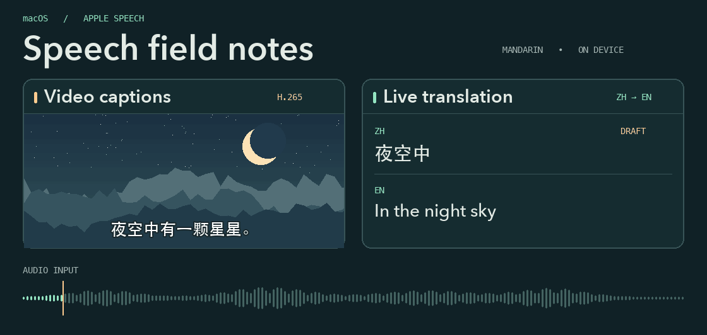
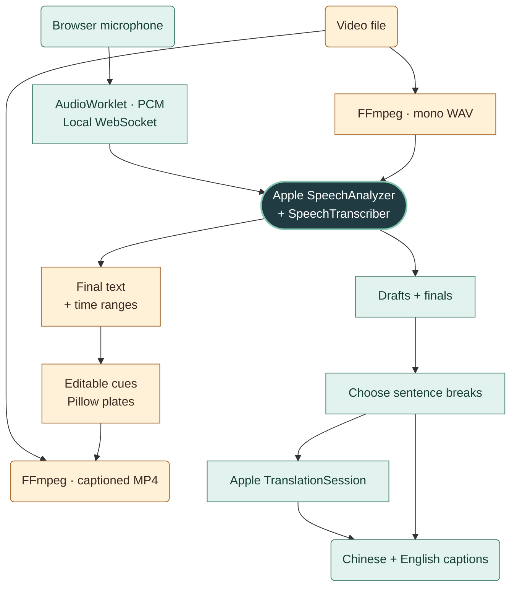

<h1 align="center">macOS Speech Field Notes</h1>

<p align="center"><strong>Engineering field notes · Two minimal demos · Reproducible experiments</strong><br>
One on-device Mandarin recognizer powers both video subtitles and live Mandarin-to-English translation.</p>

<p align="center">
  English · <a href="./README.zh-CN.md" lang="zh-CN">简体中文</a><br>
  By <a href="https://github.com/kinoward">Kino Ward (@kinoward)</a> ·
  <a href="https://github.com/kinoward/macos-speech-fieldnotes/stargazers"></a>
</p>

<p align="center"><code>macOS</code> <code>Apple silicon</code> <code>Swift</code> <code>on-device ASR</code> <code>video subtitles</code> <code>streaming translation</code></p>

<p align="center">
  <a href="#how-audio-becomes-captions">Architecture &amp; stack</a> ·
  <a href="#run-either-demo">Run the demos</a>
</p>

> **Final snapshot · 2026-11-18.** The demos are for study and reproduction only. The repository will receive no further updates. Use this date as the reference for the macOS and SDK versions, API behavior and timings reported here. [Demo source at that date](https://github.com/kinoward/macos-speech-fieldnotes/tree/1ed1c80effb51ccd5a6cf5bba69ab16531da4ccb/demos)

<p align="center">
  <picture>
    <source media="(max-width: 600px)" srcset="docs/assets/preview-mobile.png">
    <source media="(prefers-reduced-motion: reduce)" srcset="docs/assets/preview.png">
    
  </picture>
</p>
<p align="center"><em>One utterance, illustrated. The reviewed video caption is on the left. The live draft and final translation are on the right.</em> · <a href="docs/assets/preview.png">Still image</a></p>

## How audio becomes captions



| Read this when… | What you can reuse |
| --- | --- |
| [Choosing a local speech API](docs/en/architecture.md) | Model readiness, file and stream inputs, system versions and the boundary between local processing and asset downloads. |
| [Adding subtitles to a video](docs/en/video-captions.md) | Word timing, cue editing, legible type, audio stream copy and a two-pass size budget. |
| [Building live bilingual captions](docs/en/live-translation.md) | A revision-aware translation loop and a worked example of a pause that could reverse the speaker's meaning. |
| [Repeating or extending the experiments](docs/en/experiments.md) | Runnable probes, time origins, measured results and research questions with concrete controls. |

## Run either demo

Tested on **Apple silicon with macOS 27.3 and the macOS 27.2 SDK**. Both demos compile Swift locally and work without a cloud API key. Prepare the Mandarin speech asset once. The live demo also needs the Simplified Chinese and US English translation languages in **System Settings → General → Language & Region → Translation Languages**. [Compatibility and asset setup](docs/en/architecture.md)

**A · Burn subtitles into a video.** Use Python 3 with Pillow and an FFmpeg installation including `ffprobe`, `libx264` for the sample and `libx265` for export. From the repository root:

```bash
python3 -m venv .venv
source .venv/bin/activate
python -m pip install -r demos/video-captions/requirements.txt
./demos/video-captions/run --prepare
./scripts/make-sample scratch/sky.mp4
./demos/video-captions/run scratch/sky.mp4 scratch/captioned.mp4
```

Open `scratch/captioned.mp4`. Its editable timeline is `scratch/captioned.cues.json`. Substitute your own SDR MP4 with AAC to try a different voice. [Review and re-render](docs/en/video-captions.md)

**B · Speak Mandarin, read English.** Install Node.js 22+ with npm. The launcher installs its one locked dependency on first use.

```bash
./demos/live-translation/run --prepare
./demos/live-translation/run
```

In the local browser page, click **开始收听** (start), allow the microphone and speak Mandarin. Click **停止收听** (stop) to finish the last pair. Press Ctrl-C in the terminal to close the service. [Live protocol and timing](docs/en/live-translation.md)

## A result worth reproducing

In the synthetic sample, the recognizer heard **望远镜** (“telescope”) as **望远近**. The English preview inherited the error. A file user can edit one cue and re-render from the original. A live client needs to replace an earlier translation whenever the underlying words change. The probes show how to observe that difference and how to measure draft latency separately from finalization. [Experiment log](docs/en/experiments.md)

## Reading the commit history

Read the commits in chronological order to trace the work from file transcription through video captioning, live translation and sentence segmentation. The history follows Conventional Commits 1.0.0, with one logical change per commit. For example, `fix(live): keep timed commas with their preceding clause` records a specific segmentation decision. The commit body explains the reason for the change and how it was checked. [Commit specification](https://www.conventionalcommits.org/en/v1.0.0/) · [Project history](https://github.com/kinoward/macos-speech-fieldnotes/commits/main/)

## License

The **MIT License** covers the original code, field notes and silent illustrations. You may use, modify and redistribute them, including for commercial purposes. Keep the copyright and permission notices in all copies or substantial portions. The materials come without warranty. [Full license](LICENSE)

The sample generator creates audio locally. Model assets, system voices, fonts and third-party dependencies have their own license terms. [Data and materials](docs/en/architecture.md#data-and-materials)
