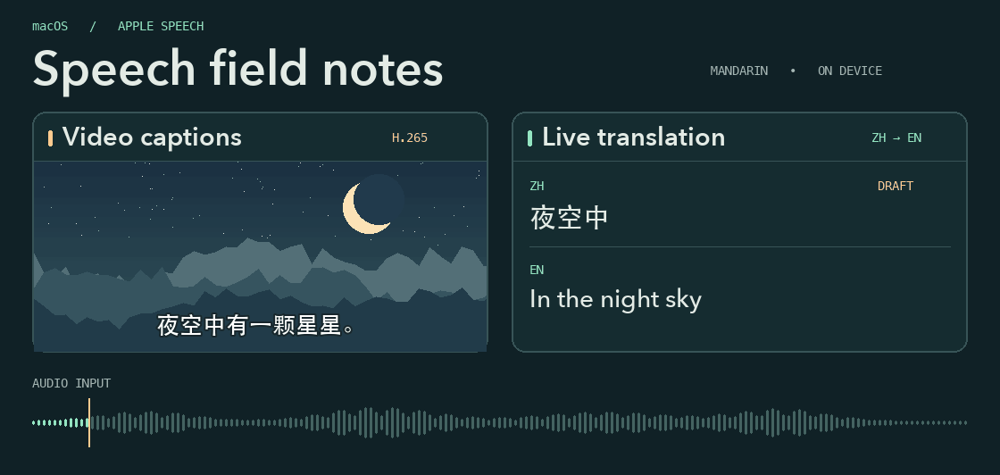
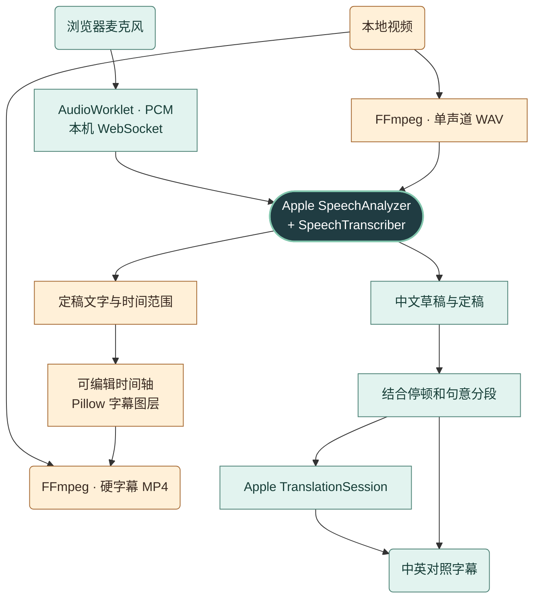

<h1 align="center">macOS 本地语音识别实践笔记</h1>

<p align="center"><strong>技术实践笔记 · 两个最小示例 · 可复现实验</strong><br>
用同一个端侧普通话识别器为视频加字幕，也把麦克风里的中文实时译成英文。</p>

<p align="center">
  <a href="./README.md" lang="en">English</a> · 简体中文
</p>

<p align="center">
  <a href="https://github.com/kinoward"></a>
  <a href="https://github.com/kinoward/macos-speech-fieldnotes/stargazers"></a>
</p>

<p align="center">
  <a href="docs/zh-CN/experiments.md"></a>
  <a href="docs/zh-CN/architecture.md"></a>
  <a href="docs/zh-CN/architecture.md"></a>
  <br>
  <a href="docs/zh-CN/architecture.md"></a>
  <a href="docs/zh-CN/video-captions.md"></a>
  <a href="docs/zh-CN/live-translation.md"></a>
</p>

<p align="center">
  <a href="#按问题找方案">按问题找方案</a> ·
  <a href="#沿着音频看架构">技术架构</a> ·
  <a href="#运行任一-demo">运行示例</a>
</p>

> **2026-11-18 定稿**。笔记和示例均已定稿，后续不再更新。文中的版本和测量结果以这一天为准。[定稿时的示例源码](https://github.com/kinoward/macos-speech-fieldnotes/tree/1ed1c80effb51ccd5a6cf5bba69ab16531da4ccb/demos)

## 按问题找方案

- **怎样把普通话 WAV 转成带时间戳的 JSON？** Swift 转写工具会为每段文字标出起止时间，单位为秒。[Swift 转写源码](demos/video-captions/Transcribe.swift)
- **怎样避免停顿改变译文的意思？** 在“我没有说要……关掉走廊的灯”中间断句，后半句就可能被译成关灯指令。[断句规则](docs/zh-CN/live-translation.md#怎样决定断点) · [回放 700 ms 停顿](docs/zh-CN/experiments.md#复现测量)
- **怎样防止迟到的旧译文重新上屏？** 中文被修订后，界面先核对英文回复对应的原文版本，再决定是否显示。[显示逻辑](demos/live-translation/public/revisions.js)
- **怎样确认烧录字幕后音画仍然同步？** 对照原片逐帧检查显示时间，并核对 AAC 音频包的哈希。[媒体检查脚本](experiments/check-media.py) · [验收记录](docs/zh-CN/experiments.md#验收记录)

**运行两个示例需要 Apple 芯片 Mac、macOS 27+ 和 macOS 27+ SDK。** 首次使用需准备普通话识别模型。实时翻译还需下载简体中文和美式英语语言包。[环境准备](docs/zh-CN/architecture.md#准备一台-mac)

<p align="center">
  <picture>
    <source media="(max-width: 600px)" srcset="docs/assets/preview-mobile.png">
    <source media="(prefers-reduced-motion: reduce)" srcset="docs/assets/preview.png">
    
  </picture>
</p>
<p align="center"><em>同一句话的两种呈现：校对后烧录进视频的字幕，以及从草稿更新到定稿的实时译文。</em> · <a href="docs/assets/preview.png">查看静态图</a></p>

## 沿着音频看架构

两个示例共用同一个识别器。处理视频时，可以在导出前改正一个错字。实时翻译时，观众先看到的是草稿，识别器每次修订中文，界面上的译文也要跟着更新。

- **共享识别器。** Swift 和 AVFoundation 将文件或麦克风音频送入 Apple 的 `SpeechAnalyzer` 和 `SpeechTranscriber`。[音频格式与时钟](docs/zh-CN/architecture.md)
- **视频字幕。** Python 和 Pillow 绘制校对后的字幕，FFmpeg 通过 libx265 把字幕烧进画面，同时复制 AAC 音轨。有体积预算时采用两遍编码。[视频处理流程](docs/zh-CN/video-captions.md)
- **实时翻译。** 浏览器的 AudioWorklet 通过本机 WebSocket 把 PCM 音频传给 Node.js。Swift 选择断句位置，再用 Apple 的 `TranslationSession` 翻译修订后的文字。[流式传输协议](docs/zh-CN/live-translation.md)



要复现实测结果，可以从文件识别计时和实时音频回放入手。实验记录列出了输入样本、计时起点和对照条件。[实验方法与结果](docs/zh-CN/experiments.md)

## 运行任一 Demo

实测环境为 **macOS 27.3 和 macOS 27.2 SDK**。两个 Demo 均在本机编译 Swift，无需云端 API 密钥。

### 把字幕烧进视频

准备 Python 3、Pillow 和 FFmpeg。生成示例需要 `libx264`，导出需要 `libx265`，读取媒体信息需要 `ffprobe`。在仓库根目录执行以下命令。

```bash
python3 -m venv .venv
source .venv/bin/activate
python -m pip install -r demos/video-captions/requirements.txt
./demos/video-captions/run --prepare
./scripts/make-sample scratch/sky.mp4
./demos/video-captions/run scratch/sky.mp4 scratch/captioned.mp4
```

打开 `scratch/captioned.mp4` 即可观看，旁边的 `scratch/captioned.cues.json` 是可编辑的时间轴。也可以换成自己的 SDR 视频，第一条音轨需为 AAC。[校对和重新烧录](docs/zh-CN/video-captions.md)

### 说中文，看英文

准备 Node.js 22+ 和 npm。首次启动时，脚本会安装锁文件指定的一个依赖。

```bash
./demos/live-translation/run --prepare
./demos/live-translation/run
```

在本机网页点**开始收听**，允许麦克风并说中文。点**停止收听**后，网页会收完最后一组字幕。在终端按 Ctrl-C 可关闭服务。[实时协议和计时](docs/zh-CN/live-translation.md)

## 一个值得复现的细节

在合成样例中，识别器把“望远镜”听成了“望远近”，英文预览也继承了这个错误。视频用户可以只改一条字幕，从原片重新烧录。实时客户端则需要在原文被修订时替换旧译文。实验手册给出了观察这两种行为的方法，也说明了预览延迟和定稿时间应怎样分别测量。[实验记录](docs/zh-CN/experiments.md)

## 贡献者

<p>
   &nbsp;<strong>Kino Ward</strong> · <a href="https://github.com/kinoward">@kinoward</a>
</p>

## 如何阅读提交历史

按时间顺序阅读提交，可以看到实验怎样从文件识别发展到视频字幕、实时翻译和断句。提交历史遵循 Conventional Commits 1.0.0，每次提交聚焦一项改动。例如，`fix(live): keep timed commas with their preceding clause` 记录了逗号应归入前一分句的决定，提交正文说明了原因和验证方法。[提交规范](https://www.conventionalcommits.org/zh-hans/v1.0.0/) · [项目提交历史](https://github.com/kinoward/macos-speech-fieldnotes/commits/main/)

## Star 趋势

<p align="center">
  <a href="https://www.star-history.com/?repos=kinoward%2Fmacos-speech-fieldnotes&amp;type=date">
    <picture>
      <source media="(prefers-color-scheme: dark)" srcset="https://api.star-history.com/chart?repos=kinoward/macos-speech-fieldnotes&amp;type=date&amp;legend=top-left&amp;theme=dark">
      
    </picture>
  </a>
</p>

页首徽章显示当前 Star 数量，这张图按日期展示变化。有多个日期的数据点后才会形成折线。[查看交互图表](https://www.star-history.com/?repos=kinoward%2Fmacos-speech-fieldnotes&type=date)

## 开源协议

本仓库的原创代码、技术笔记和无声插图采用 **MIT 许可证**。你可以使用、修改和再分发这些内容，也可以商用。复制全部或实质性部分时，须保留版权声明和许可声明。这些材料按原样提供，不附带任何担保。[许可证全文](LICENSE)

示例音频在本机生成。模型资源、系统音色、字体与第三方依赖各自适用其许可条款。[数据与素材说明](docs/zh-CN/architecture.md#数据与素材)
