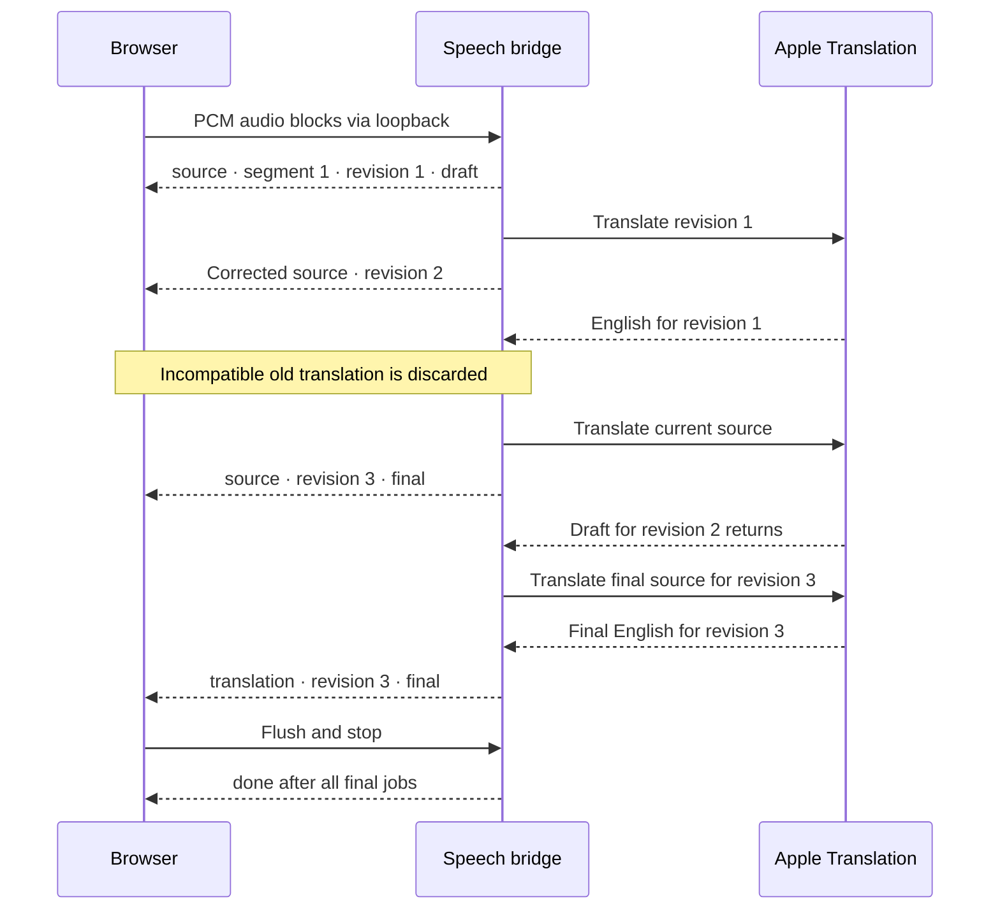

# Live translation · when to revise a subtitle

[Field notes](../../README.md) · [简体中文](../zh-CN/live-translation.md)

**Input** · One browser microphone, spoken Mandarin. **Output** · A local page with paired Chinese and English captions. Chinese can arrive while the speaker is still talking. The translator receives a complete string on each call; the application makes English feel live by translating successive drafts. [Apple TranslationSession](https://developer.apple.com/documentation/translation/translationsession)

## Walk one utterance through the app

The worklet streams mono PCM16LE at 16 kHz in roughly **90 ms** messages. Node accepts one same-origin connection at `/stream` on the loopback interface and starts one Swift process. Swift converts the PCM buffers to the recognizer's requested format, tracks sample time and reads `SpeechTranscriber.results`. Its newline-delimited JSON becomes text messages on the same WebSocket. [Capture](../../demos/live-translation/public/pcm-worklet.js) · [Local server](../../demos/live-translation/server.mjs) · [Swift bridge](../../demos/live-translation/SpeechBridge.swift)



A result has a `type` (`source` or `translation`), `segmentId`, `revision`, `final` and `text`. Both languages must agree on the final revision. A displayed segment can contain several sections, separated by two newlines and translated separately. Each segment has one DOM row with one cell per language.

A newer source that **only appends** can retain a useful partial translation. A correction in the middle clears it. A late English draft is published only when the bridge proves a safe prefix or an exact match; the browser accepts a result only for its current revision. Pending drafts coalesce while final jobs take priority. The revision test feeds “打开灯” → “别打开灯” through the UI rule and delivers the old translation deliberately out of order. [Display rule](../../demos/live-translation/public/revisions.js) · [Runnable revision test](../../experiments/revisions.test.mjs)

## Where to make a cut

| Evidence | Action in this demo | Why it matters |
| --- | --- | --- |
| Energy over 20 ms windows | Estimate background and speech levels; examine quiet intervals only after sustained voice. | The same pause looks different after a 24 dB level change. |
| At least 360 ms of quiet | Record a **candidate**. Once a result is final, map the pause to timed text runs and check the phrases on both sides. | Independent clauses can gain their own translated sections without committing an incomplete thought during speech. |
| Terminal punctuation / ordinary phrase / unfinished phrase | Request `finalize(through:)` after approximately **760 / 1,000 / 1,600 ms** respectively, when the acoustic gate and text policy agree. | “我没有说要 … 关掉走廊的灯” needs its verb and object. Finalizing the second part alone can turn it into an instruction. |
| Source punctuation and timed runs | Keep punctuation with its preceding clause, including a run containing whitespace and a comma. Evaluate each candidate within the current clause. In “如果我们明天改变计划 … 比赛的时间就要推迟”, the pronoun belongs to the condition; it gives no evidence that the consequence has begun. | The public independent-clause probe exposed a combined whitespace/Chinese-comma run. Handling that token gave the two clauses separate translations. |

These are Mandarin heuristics tuned on a small set of examples. In the new independent-clause probe, **one final segment contains two displayed sections**. Count both levels when comparing experiments. Soft boundaries appear at finalization; a live preview may briefly show the clauses together. [Apple finalization API](https://developer.apple.com/documentation/speech/speechanalyzer/finalize(through:)) · [Probe results](experiments.md)

## Stop, test and extend

Clicking Stop first asks the worklet for its partial last packet. The server then closes stdin; Swift flushes the audio converter, finalizes recognition and drains the translation queue before replying `done`. An input track ending follows the same flow. Closing the entire page instead releases the connection and its child process. The application keeps its control messages separate from the binary audio.

### Replay the negation probe

The speaker says “我没有说要”, pauses for 700 ms, then finishes “关掉走廊的灯”. The expected translation keeps “I didn’t say to turn off the hallway light” together. To try it without a microphone, prepare the speech and translation assets and install FFmpeg. Run both terminals from the repository root. [Language setup](architecture.md#prepare-a-mac)

```bash
# Terminal 1
OPEN_BROWSER=0 ./demos/live-translation/run
```

Generate the fixtures once using the installed Mandarin `say` voice (Tingting by default). If `scratch/probes` already contains the fixtures, go straight to the replay command.

```bash
# Terminal 2
mkdir -p scratch
./experiments/make-probes scratch/probes
node demos/live-translation/replay.mjs \
  scratch/probes/negation.wav --expect negation --text
```

Inspect the final English and the section count. The check expects one section and a negated reference to the light. Press Ctrl-C in the server terminal when finished. For another recording, replace the WAV path and omit `--expect negation`. [Expected content](../../experiments/probe-expectations.mjs) · [Experiments and timing](experiments.md)
