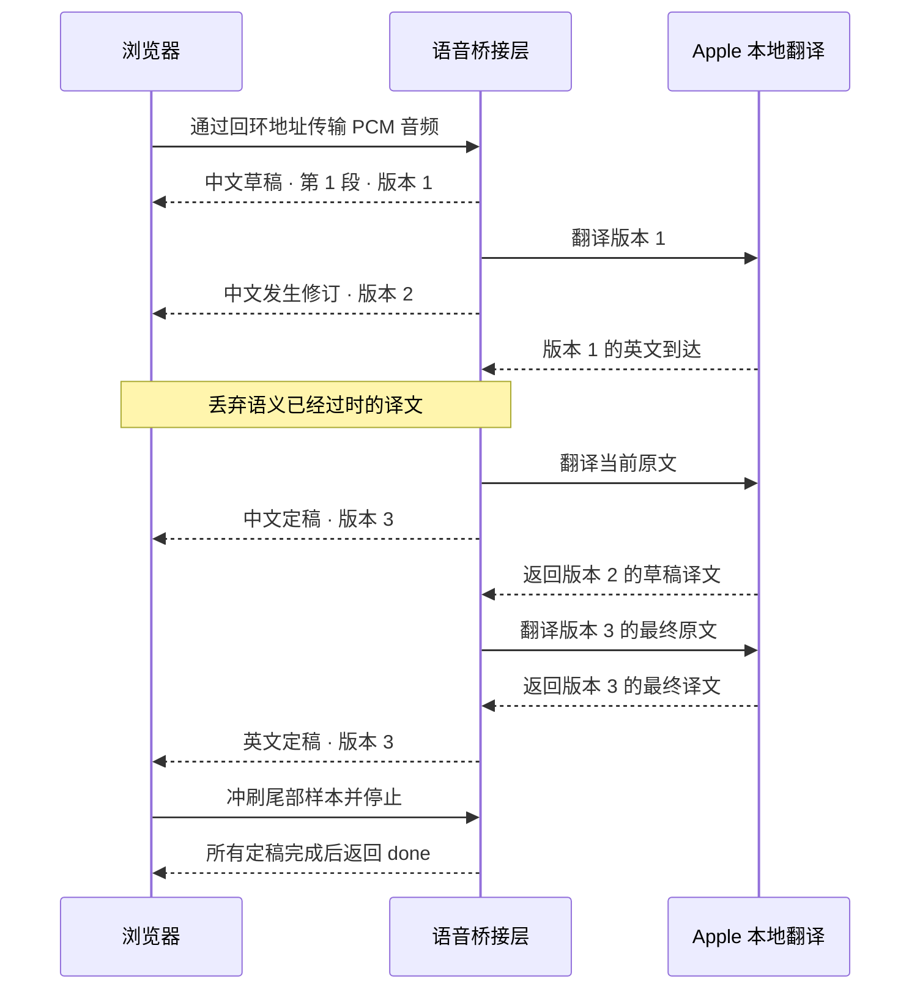

# 实时翻译 · 何时修订一条字幕

[实践笔记](../../README.zh-CN.md) · [English](../en/live-translation.md)

**输入**为一个浏览器麦克风采集的普通话。**输出**是本机网页上的中英文字幕。讲话时即可看到中文，翻译器每次接收一个完整字符串。应用通过连续提交不同版本的草稿，让英文也能陆续显示。[Apple TranslationSession](https://developer.apple.com/documentation/translation/translationsession)

## 跟着一句话走一遍

AudioWorklet 把麦克风转换为 16 kHz 单声道小端 PCM16，每约 **90 毫秒**发送一块。Node 仅在本机回环地址 `/stream` 接受一个同源连接，为该会话启动一个 Swift 进程。Swift 把 PCM 转换为识别器接受的格式，按采样数计时，读取 `SpeechTranscriber.results`。它逐行输出 JSON，由 Node 通过同一个 WebSocket 传回网页。[音频采集](../../demos/live-translation/public/pcm-worklet.js) · [本机服务](../../demos/live-translation/server.mjs) · [Swift 桥接](../../demos/live-translation/SpeechBridge.swift)



每条结果包含 `type`（`source` 或 `translation`）、`segmentId`、`revision`、`final` 和 `text`。最终原文与译文的版本必须对应。一个分段可以包含多个显示小节，以两个换行分隔并分别翻译。每个分段在网页上占一行，左右两格分别保存中文和英文。

新原文只在末尾追加时，已有的部分译文仍可保留。中间词语发生修改时，要清掉旧译文。桥接层仅在能够确认前缀关系或完全相同时才发布晚到的草稿译文；浏览器仅接收对应当前版本的结果。待处理的草稿合并，定稿任务优先。可运行的测试将“打开灯”改为“别打开灯”，再故意让旧译文晚到。[网页修订规则](../../demos/live-translation/public/revisions.js) · [修订测试](../../experiments/revisions.test.mjs)

## 怎样决定断点

| 依据 | Demo 的处理 | 原因 |
| --- | --- | --- |
| 每 20 毫秒的音量 | 估计环境底噪和语音强度；检测到持续语音后才判断安静区间。 | 音量降低 24 dB 后，同一停顿的绝对能量会变化。 |
| 安静达到 360 毫秒 | 先登记**候选**。识别结果定稿后，再将停顿对齐到有时间范围的文本，检查两侧句法。 | 两个独立分句可以分别翻译，也能给仍在形成的语义留出时间。 |
| 句末标点、普通语段、未完成语段 | 声学和文本条件均满足后，分别在约 **760、1,000、1,600 毫秒**时申请 `finalize(through:)`。 | “我没有说要……关掉走廊的灯”需要保留谓宾关系，单独翻译停顿后的片段容易变成指令。 |
| 标点与词级时间 | 标点随前句，识别“空格＋逗号”合在同一时间片的情况，同时保护条件从句、接续词和常见名词短语。 | 本次独立分句样例就产生了带空格的中文逗号。处理这个细节后，两句话各自获得译文。 |

这些中文规则来自有限样例。新的独立分句测试实际得到的是**一个定稿分段中的两个显示小节**，比较实验结果时应分别统计。较短停顿的细分发生在定稿阶段，草稿可能暂时把两句话显示在一起。[Apple 定稿接口](https://developer.apple.com/documentation/speech/speechanalyzer/finalize(through:)) · [实测结果](experiments.md)

## 停止、复测与扩展

点击停止时，先要求 AudioWorklet 交出最后一块不足整包的音频，再由服务端关闭标准输入。Swift 冲刷音频转换器、完成识别、处理完待定稿翻译，最后发出 `done`。输入音轨意外结束走同一路径。直接关闭网页则释放连接和子进程。控制消息与二进制音频分别处理。

```bash
# 终端 1，语言资源准备好后启动
OPEN_BROWSER=0 ./demos/live-translation/run

# 终端 2，按麦克风速度回放本地样例
node demos/live-translation/replay.mjs scratch/sky.mp4 --text
node --test experiments/revisions.test.mjs
```

回放会输出计时，并检查最终段号、版本号和小节数。加 `--text` 会将文字一并打印在终端；仅测时间时可省略。实体麦克风权限、说话距离变化和多人重叠是这类回放无法测量的变量。[网页实现](../../demos/live-translation/public/app.js) · [实验设计](experiments.md)
